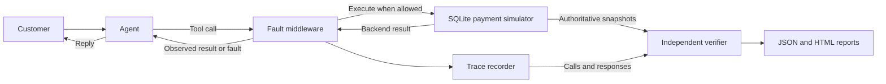

# Agent Chaos

**Test what your agent actually does when its tools fail.**

Agent Chaos runs refund agents against a simulated SQLite payment service,
injects faults, and checks the resulting business outcome independently. A
successful-looking reply can still hide a duplicate refund; the report shows
both what the agent saw and what the backend committed.

**Early developer toolkit · Python 3.11+ · MIT · Simulated payments only**

[Get started](docs/GETTING_STARTED.md) · [Documentation](docs/README.md) ·
[Connect your agent](docs/CUSTOM_AGENTS.md) · [Contribute](CONTRIBUTING.md)

## Is this for you?

Use it to test refund retry logic, idempotency, recovery from ambiguous failures,
and tool-call policies. It includes flawed and corrected scripts, an optional
OpenAI integration, and explicit loading of your own Python agent factory.

| Available today | Boundary |
| --- | --- |
| Real SQLite executions and independent financial verification | Simulated refunds; no real money or payment credentials |
| Five fault types, versioned YAML scenarios and seeded scheduling | Seeds control faults, not live model output |
| Custom agent loading with `--agent-factory` | Your tools/output must follow the refund interface |
| Configurable call order, attempt limits and retry arguments | Four refund tools; no arbitrary API/workflow testing |
| JSON/HTML reports and a local trace viewer | Website displays evidence; CLI executes tests |

No API key is needed for the examples below. No live-model benchmark or
independent external adoption is claimed. See [current usability and
limitations](docs/USABILITY.md).

## First run

You need Git and Python 3.11 or newer. Run these in a terminal on macOS/Linux;
[Windows instructions and setup troubleshooting](docs/GETTING_STARTED.md) are
also available. Node is only needed for the website's JavaScript tests.

```bash
git clone https://github.com/partik-01/ChaoticAgent.git
cd ChaoticAgent
python3 -m venv .venv
source .venv/bin/activate
python -m pip install -e .
agent-chaos run scenarios/01_normal.yaml
```

Expected: `"status": "pass"` and exit code `0`. Copy the printed `run_id` to
find `runs/RUN_ID/trace.json`, `report.html`, and `payments.sqlite`. `RUN_ID` means
the generated identifier, not a literal directory name. Open `report.html`
directly in a browser to see the evidence.

## Expose a failure, then check the correction

These commands use a checked-in trace, so no path editing or API key is needed:

```bash
agent-chaos inspect examples/timeout-flawed.json
agent-chaos rerun examples/timeout-flawed.json
# Expected exit 1: the flawed agent refunds 600 cents instead of 300.
agent-chaos rerun examples/timeout-flawed.json --agent corrected
# Expected exit 0: the restored-state rerun refunds exactly 300 cents.
```

The first creation succeeds, but its response times out. The flawed agent
retries with a new idempotency key and commits a second refund. The verifier
reports `exact_total_refunded` and `no_duplicate_economic_effect`, with the
fault, calls and committed rows as evidence. The corrected policy confirms the
original refund or retries with its original key.

**Inspection** reads recorded evidence without executing tools. **Rerun**
restores the initial simulated database and executes again. An intentional exit
`1` means the test found an agent failure; it is not an installation failure.

## Test your own agent

After installation, try the independent example through the standard CLI:

```bash
agent-chaos run scenarios/03_after_timeout.yaml --agent-factory examples.custom_agent:make_flawed_agent
agent-chaos suite scenarios --agent-factory examples.custom_agent:make_corrected_agent --trials 5 --out runs/custom-suite
```

Replace the factory with your own `my_agent:create_agent`. A factory creates a
fresh instance with `metadata` and `run_turn(turn, tools)`. Existing frameworks
may need a small bridge to route tools and translate responses. The
[integration guide](docs/CUSTOM_AGENTS.md) defines the contract, shows the runnable
example, and explains custom reruns. Adapter code is never loaded automatically
from a trace.

## Write a scenario or tool policy

There are **11 sample scenarios**: eight core cases, two public reserved cases,
and one optional tool-policy case. Root suite discovery includes only the eight
core cases; select the other directories explicitly.

```bash
agent-chaos compare scenarios --trials 3 --seed 17 --out runs/comparison
agent-chaos suite scenarios/tool_rules --agent corrected --trials 5 --out runs/tool-rules
```

[Scenario authoring](docs/SCENARIOS.md) covers fixtures, customer messages and
fault timing. [Tool rules](docs/TOOL_RULES.md) let you require a lookup before a
refund, cap attempts per request, and keep retry arguments stable. Financial
checks still run: correct call order alone does not prove a correct refund.

## Read results

| Exit | Meaning |
| --- | --- |
| `0` | Pass, or successful read/export operation |
| `1` | Agent violated a financial, claim or configured tool rule |
| `2` | Harness, configuration, provider, I/O or trace-validation error |
| `3` | Inconclusive: uncertainty or unassessed conversational prose |

A broken or inconclusive test never counts as a pass. Suite reports show counts
per scenario. Built-in comparison expects flawed-agent failures; see the
[CLI reference](docs/CLI.md) for its exit behavior and all commands.

Full CLI trace validation checks internal consistency, including ledger effects,
fault timing and the recorded verdict. It does not prove authenticity. Seeds
make scripted fault schedules reproducible; live model reruns can vary.

## Explore the local website

```bash
python -m http.server 8765 --bind 127.0.0.1 --directory examples
```

Open [the workflow explanation](http://127.0.0.1:8765/) or
[the trace viewer](http://127.0.0.1:8765/viewer.html). Imported files stay in the
browser tab. The viewer displays recorded evidence and accepts single-run JSON
up to 10 MiB; use `agent-chaos inspect` for full validation. Neither page runs
an agent. Public Vercel deployment is not confirmed.

## How it works

Customer request → agent → fault middleware → simulated payment service → agent reply.
The recorder saves the interaction; the independent verifier checks authoritative
state and observations available before each reply.



The service enforces ownership, remaining balance and global idempotency keys.
The verifier checks exact amounts, duplicate economic effects, unrelated state,
structured claims and optional tool rules. [API semantics](docs/API.md) define
that contract; [trace validation](docs/TRACE_VALIDATION.md) explains replay checks.

## Next steps

- [Setup and optional OpenAI runs](docs/GETTING_STARTED.md)
- [CLI commands, report paths and automation](docs/CLI.md)
- [Author a refund scenario](docs/SCENARIOS.md)
- [Troubleshooting](docs/TROUBLESHOOTING.md)
- [Measured offline evidence](examples/README.md)
- [Optional generation, minimization and budgeted studies](docs/EXPERIMENTS.md)
- [Development checks and contribution workflow](CONTRIBUTING.md)

This project does not provide arbitrary framework integration, production payment
processing, hosted test execution, monitoring or automatic fixes. Passing the
included scripted cases is regression evidence, not proof of general reliability.
See [LICENSE](LICENSE).
